 

  <a href="https://github.com/samranahmad09/WhateverXe-RaptorLakeP"><b>WhateverXe-RaptorLakeP</b></a>: C++ kernel extension, fork of <a href="https://github.com/b00t0x/WhateverXe">b00t0x/WhateverXe</a>
  &nbsp;·&nbsp;
  <a href="https://github.com/samranahmad09/OpenCore-Legacy-Patcher-RaptorLakeP"><b>OpenCore-Legacy-Patcher-RaptorLakeP</b></a>: installs the acceleration stack
  &nbsp;·&nbsp;
  <a href="https://github.com/samranahmad09/WhateverXe-RaptorLakeP/blob/main/docs/raptor-lake-p-findings.md">hardware findings</a>

 

  
  
  

 

### ◆ Other builds

- [**Respite**](https://github.com/samranahmad09/hackathon-fortyguard): an agent that answers questions about overnight urban heat in Phoenix from measurements, and says when the data can't support the question. FortyGuard Hackathon'26. [Live](https://respite.samtechpk.com)
- [**Nabz**](https://github.com/samranahmad09/nabz): outbreak early warning for district health offices. Health workers report in Urdu, Roman Urdu or English, by tap or voice note; the AI clusters cases by symptom, place and time. GDG AI Seekho Builders Day 2026.
- [**Kiran**](https://github.com/samranahmad09/kiran-companion): a private, Urdu-first breast-health companion agent that never asks for a photo.
- [**vibe-coding**](https://github.com/samranahmad09/vibe-coding): a web app built at a coding competition.

Cards are rebuilt from live GitHub data every 8 hours by <a href=".github/workflows/refresh.yml">a workflow in this repo</a>.

